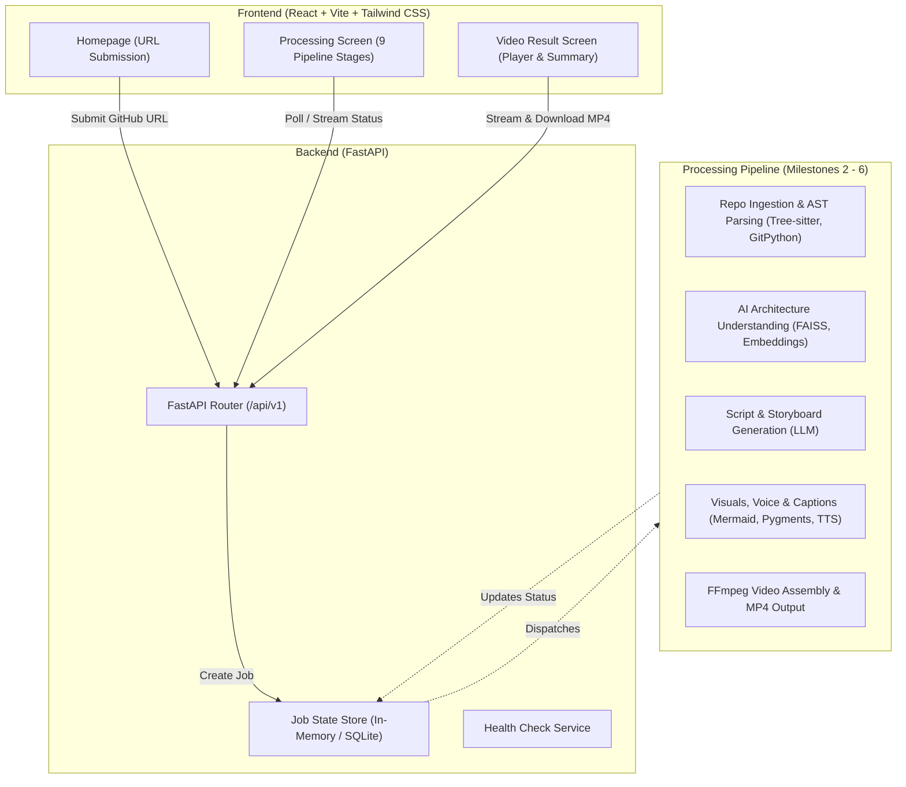

# RepoGenie

> **AI-Powered GitHub Repository to Educational Video Generator**

RepoGenie converts public GitHub repositories into structured, engaging educational videos. By analyzing source code, architectural components, dependency relationships, and data flows, RepoGenie produces a complete video walkthrough featuring technical visuals, architectural diagrams, synchronized voice narration, and captions.

---

## Architecture Overview



---

## Milestones Status

### Milestone 1: Project Foundation & UI Skeleton
- [x] Complete directory structure established
- [x] React + Vite + Tailwind CSS frontend with light developer-tool aesthetic
- [x] Three primary screens implemented (Homepage, Processing Screen with 9 stages, Video Result Screen)
- [x] FastAPI backend with health check and job endpoints
- [x] Frontend-backend integration verified

### Milestone 2: Repository Processing
- [x] **2.1 GitHub URL Processing**:
  - Dedicated URL parser (`backend/app/utils/github_url.py`) supporting standard, `.git`, trailing-slash, and query/fragment variants
  - Rejection of invalid URLs, non-GitHub domains, profiles, and organization roots
  - Lightweight repository verification on GitHub
- [x] **2.2 GitHub Repository Ingestion**:
  - Secure GitPython shallow cloning (`--depth=1`) under `storage/repos/{job_id}`
  - Non-overlapping target directory enforcement
  - Configurable clone timeout (`CLONE_TIMEOUT_SECONDS`) and max size budget (`MAX_REPO_SIZE_MB`)
  - Automatic directory cleanup on failed or timed-out clones
  - Safe execution: zero script/code execution on cloned repositories
  - Live frontend polling on the processing screen tracking repository fetching state
- [ ] 2.3 Repository Structure & File Hierarchy Analysis
- [ ] 2.4 AST Code Parsing with Tree-sitter

---

## Directory Structure

```
RepoGenie/
├── README.md                      # Project documentation and setup guide
├── .gitignore                     # Git ignore rules for Python, Node, & temp media
├── backend/
│   ├── .env                       # Backend local environment configuration
│   ├── .env.example               # Template environment file
│   ├── requirements.txt           # Python dependencies
│   ├── app/
│   │   ├── __init__.py            # Application package init
│   │   ├── main.py                # FastAPI entry point, CORS, and route registration
│   │   ├── core/
│   │   │   ├── __init__.py
│   │   │   └── config.py          # App settings & environment loader
│   │   ├── api/
│   │   │   ├── __init__.py
│   │   │   ├── api.py             # Router aggregator under /api/v1
│   │   │   └── routes/
│   │   │       ├── __init__.py
│   │   │       ├── health.py      # Health status endpoint
│   │   │       └── jobs.py        # Video job management & simulation endpoints
│   │   ├── models/
│   │   │   ├── __init__.py
│   │   │   └── schemas.py         # Pydantic schemas (JobResponse, StageInfo, etc.)
│   │   ├── services/
│   │   │   ├── __init__.py
│   │   │   ├── repo/              # Repository ingestion & parsing stubs (Milestone 2)
│   │   │   ├── ai/                # AI & code understanding stubs (Milestones 3 & 4)
│   │   │   ├── video/             # Visual, audio & FFmpeg stubs (Milestones 5 & 6)
│   │   │   └── storage/
│   │   │       ├── __init__.py
│   │   │       └── job_store.py   # Job tracking store
│   │   └── utils/
│   │       ├── __init__.py
│   │       └── validation.py      # GitHub repository URL parser & validator
│   └── tests/
│       ├── __init__.py
│       ├── test_health.py         # Unit tests for health check
│       └── test_jobs.py           # Unit tests for job creation and URL validation
└── frontend/
    ├── package.json               # Frontend dependencies & scripts
    ├── vite.config.js             # Vite configuration
    ├── tailwind.config.js         # Tailwind styling & brand palette
    ├── postcss.config.js          # PostCSS configuration
    ├── index.html                 # HTML entry point
    ├── .env                       # Frontend environment configuration
    ├── .env.example               # Template environment file
    └── src/
        ├── index.css              # Global styles & Tailwind directives
        ├── main.jsx               # React mount root
        ├── App.jsx                # Main application component & screen coordinator
        ├── api/
        │   └── client.js          # API client for health and jobs
        └── components/
            ├── Navbar.jsx         # Header with view switcher & live backend health badge
            ├── Footer.jsx         # Footer with architectural highlights
            ├── HeroSection.jsx    # Hero headline and central input container
            ├── UrlInputCard.jsx   # GitHub URL input with validation & sample buttons
            ├── HowItWorks.jsx     # 4-stage pipeline and capability overview
            ├── ProcessingView.jsx # 9-stage pipeline progress monitor
            └── VideoResultView.jsx# Educational video player and repository metadata
```

---

## Prerequisites

- **Python**: 3.10+ (tested with Python 3.12)
- **Node.js**: 18+ (tested with Node.js v23)
- **npm**: 9+

---

## Setup & Running Locally

### 1. Backend Setup

```bash
cd backend

# Create Python virtual environment
python3 -m venv .venv

# Activate virtual environment
# On macOS / Linux:
source .venv/bin/activate
# On Windows:
# .venv\Scripts\activate

# Install dependencies
pip install -r requirements.txt

# Create .env from template (if not already present)
cp .env.example .env

# Run FastAPI development server
uvicorn app.main:app --reload --port 8000
```

The backend will be accessible at:
- **API Root**: [http://localhost:8000](http://localhost:8000)
- **Interactive Swagger Docs**: [http://localhost:8000/docs](http://localhost:8000/docs)
- **Alternative ReDoc**: [http://localhost:8000/redoc](http://localhost:8000/redoc)
- **Health Check**: [http://localhost:8000/api/v1/health](http://localhost:8000/api/v1/health)

### 2. Frontend Setup

In a new terminal window:

```bash
cd frontend

# Install dependencies
npm install

# Start Vite development server
npm run dev
```

The frontend will be accessible at:
- **Web App**: [http://localhost:5173](http://localhost:5173)

---

## Running Automated Tests

### Backend Unit Tests

```bash
cd backend
.venv/bin/pytest -v
```

All health check and job validation tests should pass.

### Frontend Production Build Test

```bash
cd frontend
npm run build
```

Build artifacts will be emitted to `frontend/dist`.

---

## The 9 Pipeline Stages (Preview)

RepoGenie tracks video generation through 9 granular stages:

1. **Repository Fetching**: Clones the public Git repository securely into an isolated sandbox.
2. **Repository Analysis**: Inspects directory hierarchy, dependency manifests, and builds file maps.
3. **Code Understanding**: Parses AST using Tree-sitter and extracts classes, functions, and call graphs.
4. **AI Summary Generation**: Produces a grounded architectural overview without hallucinations.
5. **Script Generation**: Creates a pedagogical script explaining the application layer by layer.
6. **Storyboard Generation**: Structures the script into timed scenes with specific visual cues.
7. **Visual Generation**: Generates Mermaid diagrams, flowcharts, and syntax-highlighted code blocks.
8. **Voice Generation**: Generates synchronized voice narration with speech synthesis.
9. **Video Assembly**: Combines scenes, audio tracks, and subtitles into a 1080p MP4 via FFmpeg.
